# aurora-like

A prototype 4X strategy game in the spirit of Aurora 4X: the dawn of the
trans-Newtonian age, starting in Sol and expanding outward.

Five milestones are in: the **system map**, which models Sol to scale from real
orbital elements; the **economy, research and officer corps** that turn it into
a game you can play forward; the **command interface** built to answer Aurora's
oldest complaint - that the game shows you every number and tells you nothing;
the **automation ladder**, which stops the tenth colony being nine times the
work of the first; and **ships**, which turn the research tree's engine branch
into something that flies. It runs on a phone.

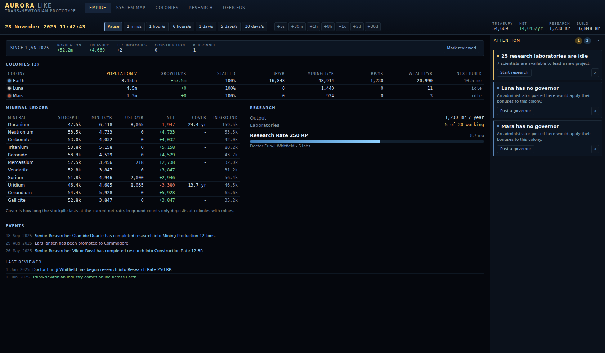

## Running it

```sh
npm install
npm run dev       # http://localhost:5173
npm run build     # typecheck + production build into dist/
npm run check     # model sanity checks (orbits, economy, people, planning)
```

`npm run ui` runs the browser checks against a running dev server, on a desktop
viewport and an emulated phone. Playwright is deliberately not a dependency of
the project, so install it first:

```sh
npm install --no-save playwright && npx playwright install chromium
npm run dev &
npm run ui
```

## The system map

A full model of Sol, to scale. 53 bodies: the Sun, eight planets, five dwarf
planets, 30 moons, the larger asteroids and two comets, plus ~1500 background
objects filling the main belt, both Jupiter Trojan camps and the classical
Kuiper belt.

Positions come from Keplerian elements, not from an artist's impression:

- Planetary elements are JPL's J2000 mean elements, converted from
  (mean longitude, longitude of perihelion) to (mean anomaly, argument of
  perihelion).
- Satellite elements are referred to their primary's equator and folded into
  the ecliptic frame, so the Uranian system really does orbit on its side and
  Triton really does run retrograde.
- Kepler's equation is solved with a bracketed Newton iteration, which holds
  up at Halley's eccentricity of 0.967 where plain Newton-Raphson diverges.

Distances are honest. There is no fudge factor: the map is a single continuous
zoom from 75 AU down to about 15,000 km, and bodies are drawn at their true
radius once they are larger than a few pixels. Moons sit at their real distance
from their primary, so the Jovian system opens up as you zoom into Jupiter
rather than being a separate screen.

Time runs at continuous rates from one minute per second up to thirty days per
second, plus discrete jumps (+5s through +30d) in the style of Aurora's turn
increments. The campaign opens on 1 January 2025.

## The interface

Aurora's economy UI is criticised for four things, and each has an answer here.

**Navigation tax** - finding the right window, tab and dropdown for every
action. The **Empire dashboard** is the landing view: one sortable table
covering every colony's population, staffing, industry, mining, research and
wealth, so the state of the empire is one screen rather than one screen per
colony. Clicking a row drills into that colony.

**No synthesis** - the game never tells you what is wrong, so you go looking.
The **attention rail** is derived from state every time it renders: stalled
build queues, deposits within five years of exhaustion, idle laboratories,
projects whose scientist retired, colonies over their supported population,
treasury deficits. Each item states the problem in a line and carries the
action that fixes it - clicking takes you to exactly where it is resolved.
Items can be dismissed for two years; nothing is stored, so a resolved problem
simply stops being raised. It folds to a 44px counter strip, which is its
default on the map.

**No consequence preview** - you commit to a queue and find out years later.
Adding to a build queue now previews it first: total build points, completion
date, what is already queued ahead, and per mineral what it consumes against
what you hold - *"Duranium 12,000 t of 47.5k held, cover 24.4 yr -> 18.2 yr"*.
An order the colony cannot pay for is flagged before it is placed.

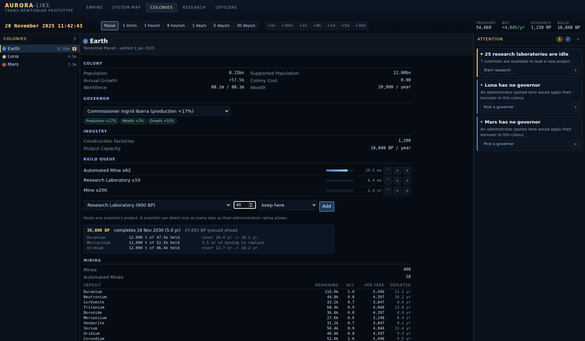

**No empire-level view of scarcity** - the **mineral ledger** gives, for all
eleven minerals at once, the stockpile, what is mined, what is committed, the
net, how many years of cover that leaves, and how much is still in the ground
at colonies that can reach it. Running out of Duranium is now something you
see coming rather than discover.

At thirty days a second it is easy to skip five years, so the dashboard also
carries a **since you last looked** strip - population, treasury, technologies
and construction since your last visit - and the event log marks where you had
read up to.

## Ships

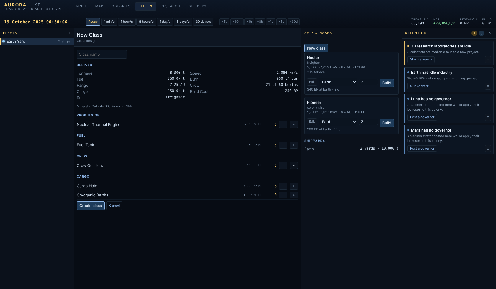

**Classes are designed, not chosen.** A hull is a bag of components - engines,
fuel tanks, crew quarters, cargo holds, cryogenic berths, survey sensors - and
every figure about the ship is derived from them: tonnage, speed, endurance,
range, crew, build cost and minerals. Nothing is stored twice, so researching a
better fuel efficiency improves every ship already flying.

Each component is gated on a technology, which is what finally gives the
engine and sensor branches of the tree something to do. At the start of a
campaign no engine has been researched, so nothing can be built; Nuclear
Thermal Engine Technology is the first thing that puts a hull in space.

Speed is engine power per hull space, as in Aurora: a 5,700-ton freighter on
two nuclear thermal engines makes 1,053 km/s and carries 100,000 tons.
Shipyards decide how large a hull a colony can lay down - 5,000 tons each -
and hulls are built through the same queue, preview and mineral accounting as
everything else.

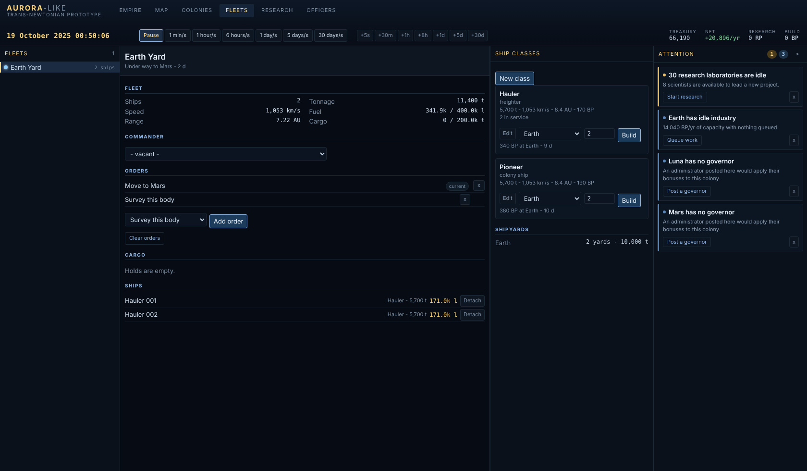

**Fleets carry out orders.** Move, load and unload installations, minerals or
colonists, refuel, survey. Movement is integrated against simulated time every
frame rather than on the production cycle, so a fleet crosses the map smoothly,
burns fuel by the hour, and arrives when it actually arrives - chasing a body
that is itself in orbit. A fleet with dry tanks stops where it is and says so.

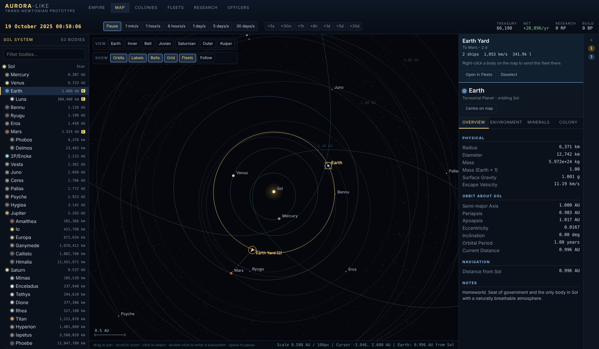

On the map a fleet is a chevron pointing along its course, with a dashed line
to its destination. Click to select it, right-click a body to send it there.

**Survey means something.** Only the worlds already settled start surveyed;
everywhere else, deposits are unknown until a ship with geological sensors has
been there. A governor will not propose mining ground nobody has looked at.

**Naval officers finally have commands.** A fleet commander's engineering
rating stretches its fuel.

**Civilian shipping can be switched off.** The stand-in that moves
installations and colonists without ships is now optional: turn it off from the
Empire view and finished installations are crated up where they were built,
waiting for a freighter you designed to come and collect them.

## Automation

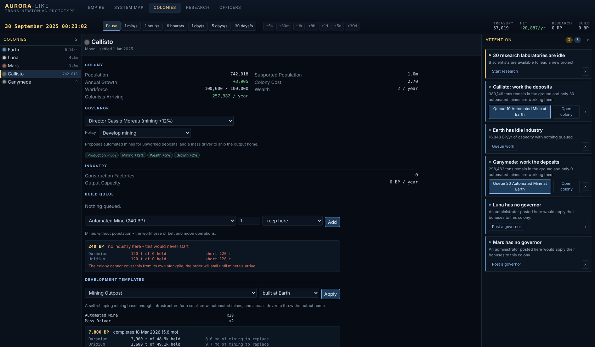

Four rungs, each only as trustworthy as the one below it.

**Bulk actions.** Tick colonies on the dashboard and apply a development
package to all of them at once, with the total cost shown before you commit.

**Templates.** A named package - *Mining Outpost* is infrastructure, thirty
automated mines and two mass drivers - applied to any world in one action,
built at a colony that has industry and shipped to the one that does not.
Infrastructure is the item that cannot be a fixed number, because how much a
world needs depends on its colony cost, so a template item can ask for *enough
infrastructure for one million colonists* and be sized on apply. Items the
empire has not researched are dropped rather than silently queued. Any build
queue can be saved as a new template.

**Standing orders.** Rules that top a colony up without being asked: keep 25
automated mines here, or keep supported population 40% ahead of actual
population - the chore that otherwise needs doing by hand on every growing
colony. They are evaluated once per production cycle, count what is already
built *and* already queued, and only ever top up to the target, so a rule
cannot run away. Work they queue is badged `auto`.

**Governor proposals.** A governor with a policy does not act - they file a
proposal into the attention rail, carrying the exact order they would place:
*"Callisto: work the deposits. 380,146 tons remain in the ground and only 30
automated mines are working them. [Queue 10 Automated Mine at Earth]"*. One tap
accepts it, one dismisses it. Automation that queues things behind your back is
what players distrust; automation that drafts the order and waits is what they
use. A satisfied policy stops proposing.

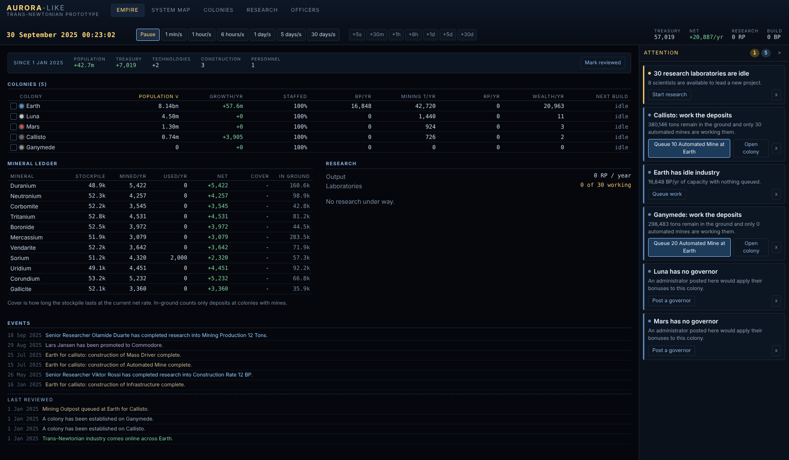

## On a phone

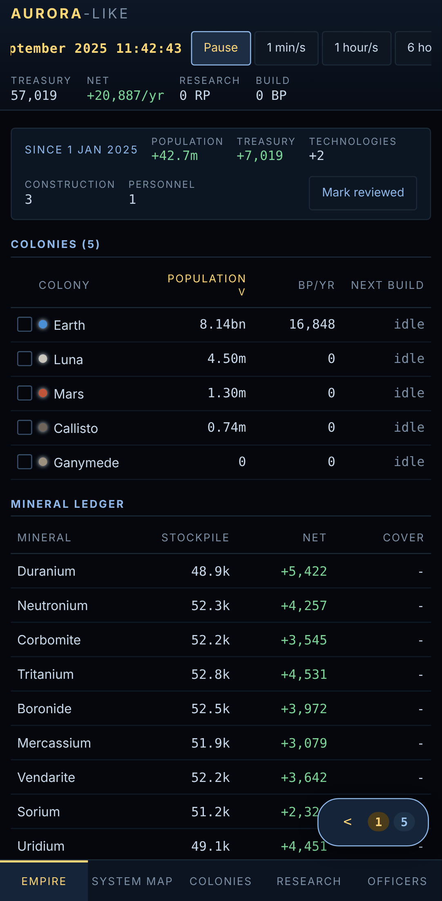
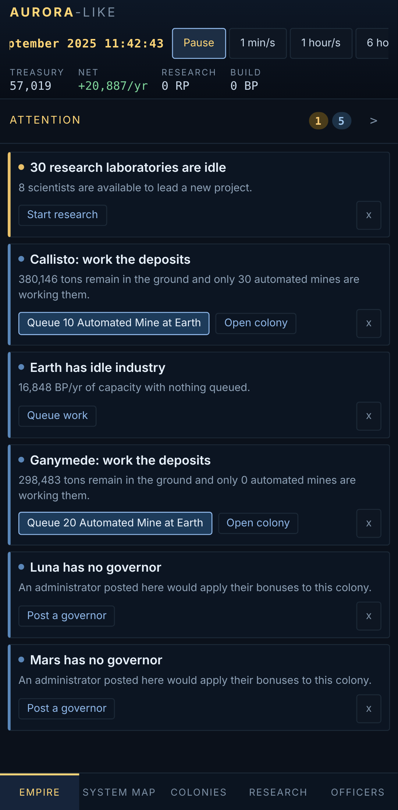

The same build, laid out for a 412px screen rather than a second cut-down app.

- View tabs move to a real bottom row - not a fixed footer, which disappears
  under the browser's own chrome the moment the URL bar collapses.
- The attention rail becomes a sheet, summoned from a floating counter and
  folded again as soon as you follow an item to its fix.
- Tables drop their least important columns instead of wrapping into mush; the
  colony list keeps name, population, industry and next completion.
- The clock and speed controls become one sticky, horizontally scrollable row.
- The map takes touch properly: one finger pans, two fingers pinch to zoom, and
  the system list stays as a strip because tapping a three-pixel moon is not
  selection.

## The economy

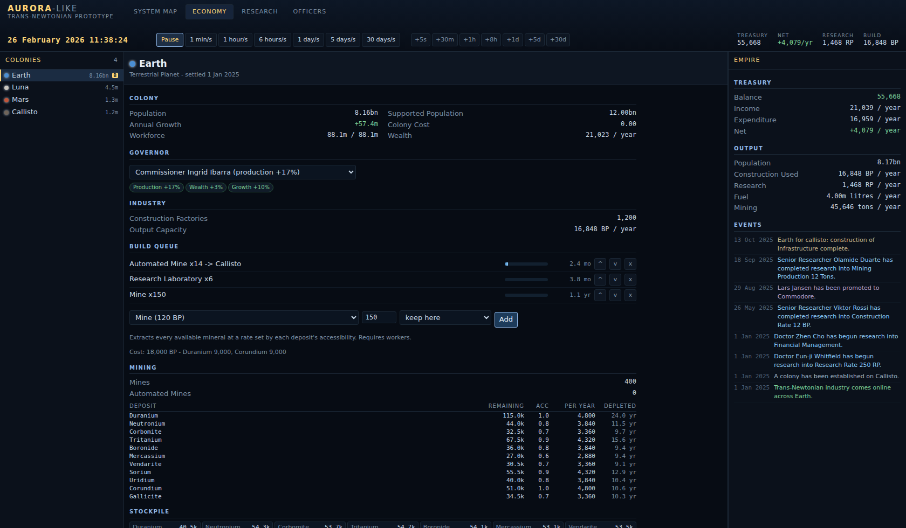

Production runs in five-day cycles. Everything is quoted per year and scaled by
the length of the cycle, so a 5-day step and a 30-day jump give identical
results.

- **Mining.** Mines and automated mines extract every mineral present on a
  body at a rate set by each deposit's accessibility. Deposits deplete and run
  out; the Economy view shows how many years each has left at the current rate.
- **Industry.** Construction factories produce build points. The build queue
  draws build points and minerals together - a half-built factory has consumed
  half its minerals - and an order that cannot draw what it needs stalls and
  says so rather than quietly conjuring material.
- **Logistics.** Mass drivers throw minerals from the outer colonies to the
  capital. Anything built at one colony can be shipped to another on
  completion, and colonists move from the capital to colonies with spare
  infrastructure. Both stand in for freighters and colony ships, which need
  ship design; without them the expansion loop would be closed.
- **Population.** Growth is logistic against what the world can support: its
  surface area for a garden world, its infrastructure divided by colony cost
  everywhere else. Colony cost falls with terraforming and with genome
  research, so a world's ceiling is something you can raise.
- **Wealth.** Taxation scales with population; construction, research and
  installation upkeep draw it down. A treasury in deficit halves industrial
  output until it recovers.
- **Employment.** Manned installations need workers. A colony that builds more
  than its population can staff runs everything at a reduced rate.

## Research

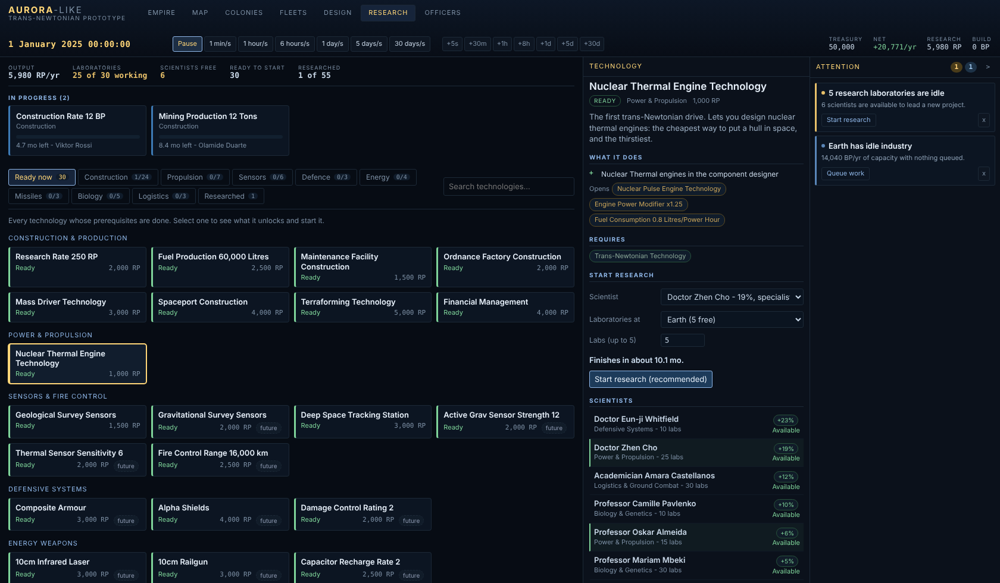

55 technologies across the eight Aurora research fields. A tech becomes
available once its prerequisites are researched, and its effects are
declarative - the empire's working figures are always recomputed from the set
of researched techs, so there is no incremental state to drift.

A project needs three things: a tech, a scientist, and laboratories on a
colony. A scientist can only direct as many labs as their administration rating
allows, so a brilliant researcher with poor administration is a specialist, not
a department head. Techs marked *future system* are real research targets whose
effects arrive with ship design, surveying and combat.

## People

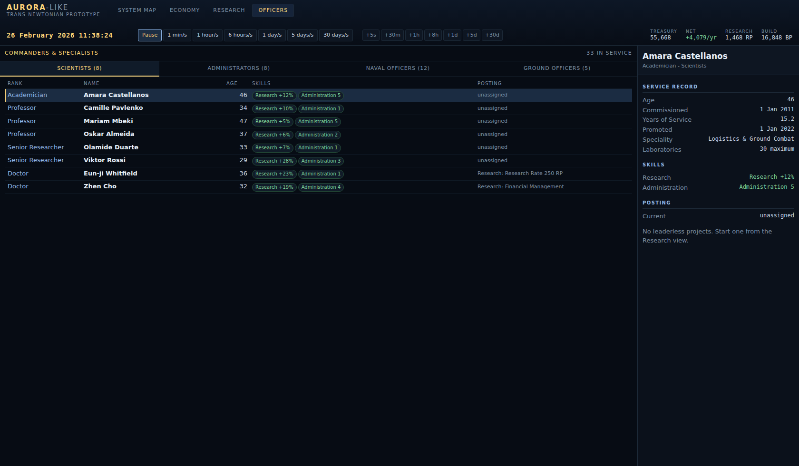

Scientists, administrators, naval officers and ground officers, each with a
name, an age, a service record, a rank and a set of skills. Officers enter
service over time (faster with military academies), are promoted on time in
rank nudged by their best skill, and retire from about 58 onward.

- **Scientists** lead research projects. Their research bonus multiplies the
  project's output and their administration rating caps its size.
- **Administrators** govern colonies, applying production, mining, wealth and
  population-growth bonuses to the world they are posted to.
- **Naval and ground officers** are tracked and promoted, but have nothing to
  command until ships and ground forces exist.

## Controls

| Input | Action |
| --- | --- |
| `E` `M` `C` `F` `R` `O` | Empire / Map / Colonies / Fleets / Research / Officers |
| Drag | Pan the map |
| Scroll | Zoom at the cursor |
| Click | Select a body |
| Double-click | Zoom to a body, framing its satellite system |
| `Space` | Pause / resume |
| `1`-`7` | Time rate |
| `G` | Follow the selected body |
| Right-click | Send the selected fleet to that body |
| `Esc` | Clear the selection |

The **View** buttons jump to preset framings (Earth, Inner, Belt, Jovian,
Saturnian, Outer, Kuiper); **Show** toggles orbits, labels, belt objects and
the AU grid.

## Layout

```
src/
  sim/        orbit.ts        Keplerian mechanics, the frame, and the solver
              issues.ts       derives the attention list from state
              clock.ts        simulation time, rates and the civil calendar
              system.ts       body tree, per-tick positions, derived figures
              minerals.ts     deposit generation
              rng.ts          seeded randomness
              economy/        installations, the production cycle, the ledger,
                              order previews, templates, standing orders
              governors.ts    policies, and the proposals they file
              ships/          components, class design, fleets and movement
              research/       the eight fields and the technology tree
              people/         officer generation, promotion, retirement
  data/       bodies.ts       the Sol dataset: elements and physical data
  render/     camera.ts       pan/zoom over the ecliptic plane
              map.ts          canvas renderer
  state/      game.ts         the clock, the loop, the opening position
              empire.ts       colonies, officers, research, treasury, log
              colony.ts       a colony and its build queue
  ui/         app.ts          input, the frame loop, view switching
              triageRail.ts   the persistent attention rail
              views/          empire, colony, research and officer views
              bodyTree.ts, detailPanel.ts, timeControls.ts, widgets.ts
tools/        sanity.ts       the checks behind `npm run check`
              ui-test.mjs     the browser checks behind `npm run ui`
              bench.ts        the scale benchmark behind `npm run bench`
```

The simulation layer knows nothing about the DOM, and the data layer knows
nothing about the simulation.

## Verification

`npm run check` runs the model against published values and its own
invariants - among them:

- Earth sits 0.9833 AU from Sol at heliocentric longitude 100.4 degrees on
  1 January 2025; Luna stays between perigee and apogee; every orbit stays
  inside its own periapsis and apoapsis over a century of simulated time.
- Minerals are conserved: over a year with nothing queued, the sum of every
  deposit, every stockpile and every litre of refined fuel is unchanged to
  within a rounding error.
- Population is conserved across migration: over one cycle the total may only
  change by the natural growth of each colony.
- Installations built for another colony arrive there and do not stay behind.
- Over a 37-year campaign the officer corps turns over, nobody outlives 85,
  and every posting still points at a colony or project that exists.
- The ledger's totals agree with the colonies they are summed from, order
  previews cost and schedule correctly against what is already queued, and
  every attention item points at something that exists.
- Attention items appear and disappear with the condition that caused them: a
  stalled queue is reported at critical severity, idle industry stops being
  reported once work is queued, and a dismissal lapses on schedule.
- Templates size infrastructure to the target world and drop what is not
  researched; standing orders deliver their target and then stop, counting what
  is already on its way; a governor proposes only with a policy and a governor,
  and stops once the policy is satisfied.
- A class's tonnage, speed, capacity and crew match the components it is made
  of; a hull larger than the slipways never starts; fuel burn matches the
  design's hourly rate; cargo and colonists are carried, not created; a dry
  tank strands a fleet where it stands.

## Performance

4X games die at scale, so there is a benchmark rather than an opinion:

```sh
npm run bench            # default: 1,000 fleets / 5,000 ships
node node_modules/.cache/bench.mjs 10000   # 10,000 fleets / 50,000 ships
```

With 48 colonies, 5,000 ships and 1,555 belt objects, on one core:

| Measurement | Cost |
| --- | --- |
| Bodies and belt objects, per frame | 0.84 ms |
| All fleets, per frame | 0.38 ms |
| One five-day production cycle | 0.68 ms |
| Empire mineral ledger | 0.35 ms |
| Attention list | 0.91 ms |
| Kepler solves | ~4.2 million/second |

That is **1.2 ms of a 16.7 ms frame** - 7% of the budget at sixty frames a
second. At ten times the navy (50,000 ships) it is 6.2 ms, still inside budget.
A whole year of game time at the fastest speed costs about 50 ms of production
cycles.

The one real bottleneck found so far was not the language: derived ship
figures were being recomputed for every ship on every frame. Caching them
against a revision counter took fleet movement from 4.27 ms to 0.38 ms - 11x -
without touching an algorithm. The lesson generalises: at this scale the cost
is recomputation and allocation, not arithmetic speed.

So the recommendation is **not** to rewrite in C++ or Rust yet. What keeps that
option open is that the simulation layer is pure and knows nothing about the
DOM, so a hot kernel can be moved to WebAssembly later without touching the
interface. The things that would change the answer are per-entity combat
resolution at sub-second increments across tens of thousands of entities,
real N-body physics instead of Keplerian elements, or simulating many empires
server-side. Even then the answer is to extract that kernel, not to rewrite the
game.

## Not built yet

Ground forces; sensors, surveying and
combat and armour; jump points and other star systems; sector administration;
ship maintenance and crew grade. Ordnance
factories, maintenance facilities, tracking stations and spaceports can be
built but do nothing yet, and mineral and colonist transport is handled by the
civilian-shipping stand-in described above rather than by freighters you build.
