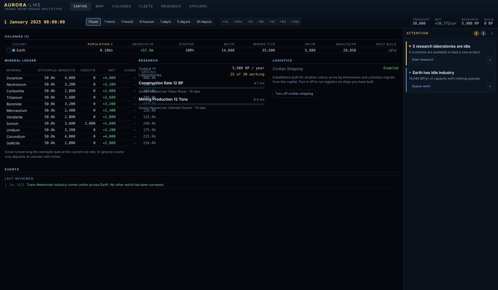
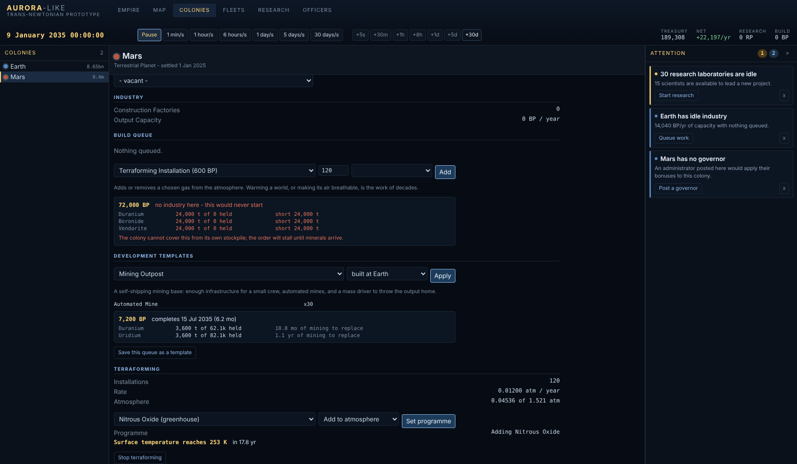
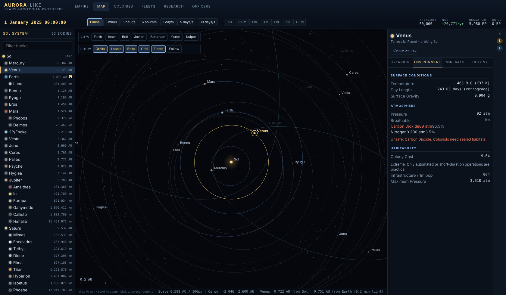
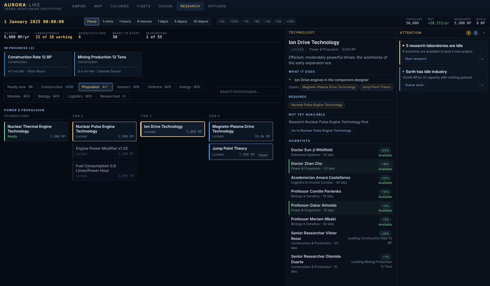
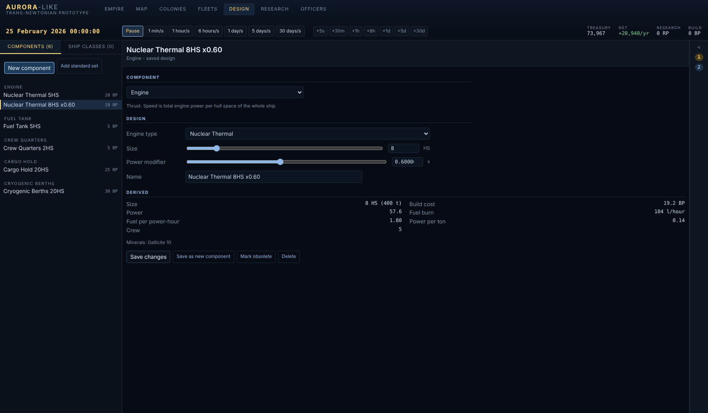
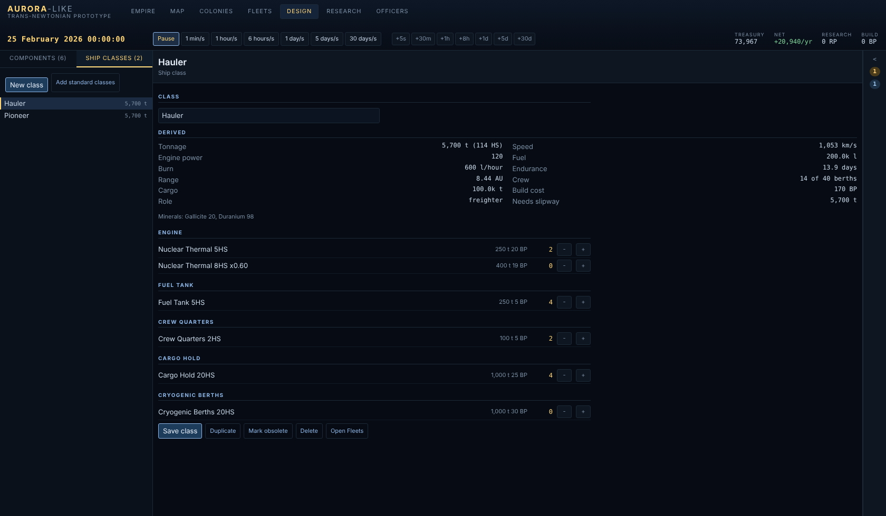

# aurora-like

A prototype 4X strategy game in the spirit of Aurora 4X: the dawn of the
trans-Newtonian age, starting in Sol and expanding outward.

Six milestones are in: the **system map**, which models Sol to scale from real
orbital elements; the **economy, research and officer corps** that turn it into
a game you can play forward; the **command interface** built to answer Aurora's
oldest complaint - that the game shows you every number and tells you nothing;
the **automation ladder**, which stops the tenth colony being nine times the
work of the first; **ships**, which turn the research tree's engine branch into
something that flies; and **terraforming**, which turns a world's atmosphere
into something you can argue with. It runs on a phone.

A campaign opens on **Earth alone**. One colony, one surveyed world,
trans-Newtonian theory and nothing else: no Lunar base, no Martian outpost, no
engine, no ship. Everything beyond Earth has to be surveyed, settled and
supplied.




## Running it

```sh
npm install
npm run dev       # http://localhost:5173
npm run build     # typecheck + production build into dist/
npm run check     # model sanity checks (orbits, economy, people, planning)
```

`npm run ui` runs the browser checks against a running dev server, on a desktop
viewport and an emulated phone. Playwright is deliberately not a dependency of
the project, so install it first:

```sh
npm install --no-save playwright && npx playwright install chromium
npm run dev &
npm run ui
```

## The system map

A full model of Sol, to scale. 53 bodies: the Sun, eight planets, five dwarf
planets, 30 moons, the larger asteroids and two comets, plus ~1500 background
objects filling the main belt, both Jupiter Trojan camps and the classical
Kuiper belt.

Positions come from Keplerian elements, not from an artist's impression:

- Planetary elements are JPL's J2000 mean elements, converted from
  (mean longitude, longitude of perihelion) to (mean anomaly, argument of
  perihelion).
- Satellite elements are referred to their primary's equator and folded into
  the ecliptic frame, so the Uranian system really does orbit on its side and
  Triton really does run retrograde.
- Kepler's equation is solved with a bracketed Newton iteration, which holds
  up at Halley's eccentricity of 0.967 where plain Newton-Raphson diverges.

Distances are honest. There is no fudge factor: the map is a single continuous
zoom from 75 AU down to about 15,000 km, and bodies are drawn at their true
radius once they are larger than a few pixels. Moons sit at their real distance
from their primary, so the Jovian system opens up as you zoom into Jupiter
rather than being a separate screen.

Time runs at continuous rates from one minute per second up to thirty days per
second, plus discrete jumps (+5s through +30d) in the style of Aurora's turn
increments. The campaign opens on 1 January 2025.

## The interface

Aurora's economy UI is criticised for four things, and each has an answer here.

**Navigation tax** - finding the right window, tab and dropdown for every
action. The **Empire dashboard** is the landing view: one sortable table
covering every colony's population, staffing, industry, mining, research and
wealth, so the state of the empire is one screen rather than one screen per
colony. Clicking a row drills into that colony.

**No synthesis** - the game never tells you what is wrong, so you go looking.
The **attention rail** is derived from state every time it renders: stalled
build queues, deposits within five years of exhaustion, idle laboratories,
projects whose scientist retired, colonies over their supported population,
treasury deficits. Each item states the problem in a line and carries the
action that fixes it - clicking takes you to exactly where it is resolved.
Items can be dismissed for two years; nothing is stored, so a resolved problem
simply stops being raised. It folds to a 44px counter strip, which is its
default on the map.

**No consequence preview** - you commit to a queue and find out years later.
Adding to a build queue now previews it first: total build points, completion
date, what is already queued ahead, and per mineral what it consumes against
what you hold - *"Duranium 12,000 t of 47.5k held, cover 24.4 yr -> 18.2 yr"*.
An order the colony cannot pay for is flagged before it is placed.


**No empire-level view of scarcity** - the **mineral ledger** gives, for all
eleven minerals at once, the stockpile, what is mined, what is committed, the
net, how many years of cover that leaves, and how much is still in the ground
at colonies that can reach it. Running out of Duranium is now something you
see coming rather than discover.

At thirty days a second it is easy to skip five years, so the dashboard also
carries a **since you last looked** strip - population, treasury, technologies
and construction since your last visit - and the event log marks where you had
read up to.

## UI refresh

A pass across every screen to make the game easier to read and drive without
hiding any of the detail.

- **Command palette** (`Ctrl/Cmd+K` or `/`): jump to any screen, colony, body,
  fleet, technology or ship class, or run a command, by typing.
- **Time and events**: speeds are a compact 1m-30d row, with quick jumps and a
  **Next event** button (`N`) that runs until something worth stopping for
  happens. Choose which event categories pause the clock in Settings.
  Important events appear as toasts that link straight to what they are about.
- **Tab badges** mark screens with something waiting; the top bar is split into
  navigation, tools and a status bar for time and treasury.
- **Colony screen**: a sticky vitals strip and tabs (Overview, Production,
  Mining & stores, Terraforming, Automation) replace one very long page.
- **Map lenses**: Natural, Habitability, Territory and Minerals tint the bodies,
  with a legend and a hover card; the detail panel offers context actions
  (open colony, settle, send a fleet, survey).
- **Empire dashboard**: a guided goals list for the Earth-only start and
  sparkline trends for treasury, population and output.
- **Foldable sections** (state remembered), **glossary hints** on statistics
  and a **density** setting (comfortable or compact).
- **Phone**: a short tab bar with a More sheet for the remaining screens.

## Saving, the digest and fleet automation

**Saving.** The game autosaves every couple of minutes while you play (a ring
of four slots, so you can rewind) and when the tab is hidden or closed, and
it resumes from the latest save when you come back. `F5` quicksaves, `F9`
quickloads, and `Ctrl+S` opens the save dialog: named saves, export to a
file, import from a file, and **New game**. Everything derived (issues,
previews, goals, research figures, ship statistics) is rebuilt on load, and a
loaded game plays on identically to the one that was saved - the model
checks play both forward and compare them.

**The return digest.** After a long run of time with news in it, a toast
offers **Review digest** once the clock is stopped; it is also in the command
palette and on the dashboard. It reports the changes in numbers, what wants a
decision now, and the events grouped by kind, each one a link to where it
happened. "Mark as read" starts the next period.

**Repeating orders.** Tick *Repeat these orders* on a fleet and finished orders
go to the back of the queue, so a circuit runs again and again.

**Fleet programmes** are standing orders for ships: the fleet follows a rule
whenever it has nothing queued, writing its own orders as it goes.

- *Survey*: the nearest unsurveyed body each time, in the whole system or out
  to a chosen range. It tops up fuel before leaving a colony, only goes where
  it can reach and come home from, will not chase a body another fleet is
  already heading for, and goes home when done. The command palette can start
  one on any fleet with survey sensors.
- *Freight line*: shuttle between two colonies. Carry minerals (all or one,
  leaving a reserve behind), stored installations, or colonists one way, and
  optionally something back. The fleet waits at the first colony until there
  is cargo, refuels at either end, and shows a forecast of round-trip time and
  tonnage a year before you commit.

Routine movements of automated fleets are logged quietly: they never stop
the clock or raise a toast, and the digest only counts them. Problems - out
of fuel, a target out of range, no sensors aboard - are still raised.

## The galaxy, jump points and exploration

Sol is not alone. Fifteen real stars within about forty light years - Alpha
Centauri, Proxima, Barnard's Star, Sirius, Tau Ceti, TRAPPIST-1 and the rest -
are in the game at their true distances and directions. Their mass,
luminosity and temperature are catalogue values, and where astronomers have
actually detected planets (Proxima b, the TRAPPIST-1 seven, Tau Ceti e and f,
Epsilon Eridani b, Gliese 1061's three...) those keep their measured periods
and minimum masses, with the orbit following from Kepler's third law.

Everything *unknown* is rolled from the campaign seed: how many more planets
there are and where, whether each is rocky, icy or gaseous, whether it holds
an atmosphere (decided by comparing escape velocity with temperature, with
flaring red dwarfs stripping the air from close-in worlds), what the air is
made of, how warm it ends up (equilibrium temperature plus the game's own
greenhouse model), and what is buried in it - each world gets an overall
richness and a few minerals it is especially rich in. Most worlds are bleak;
a few are temperate and breathable; many are terraformable. A new campaign
rolls a new galaxy; the seed is kept in saves, and `?seed=name` in the address
picks one. Sol itself is never rolled.

**Jump points** link the systems, and the network is not geography: a point
in Sol may lead to Ross 128 or to TRAPPIST-1. Every system has several, none
known at the start.

- **Finding them.** A ship with a gravitational survey sensor sits in a system
  (the *Search for jump points* order) and banks survey points; every 1,000
  points reveals the next jump point. Points are shared by all fleets working
  the same system.
- **Crossing them.** A ship needs a *jump drive* (a component, rated in tons -
  200 t per hull space - and pooled across the fleet), or the connection needs
  a gate. The first crossing reveals the far system and its planets; minerals
  still need a geological survey.
- **Gates.** A ship with a *gate construction module* sitting at a jump point
  the empire has already crossed builds a gate in a number of days set by the
  module's size. After that any ship, drive or not, can use the connection,
  and civilian shipping (migration, installations delivered between colonies)
  follows gated routes. Mass drivers still reach only within a system.
- **Routes are automatic.** A plain *Move to* order for a body in another
  system is expanded into the crossings along the shortest known route that
  the fleet can use; "No known route" is reported if there is none.
- **Settling.** The first colony in a new system needs a ship with cryogenic
  berths in orbit; after that the system can be settled freely.

**The Explore programme** automates all of it: search each system for jump
points, cross the ones nobody has been through, and carry on until the known
network is charted. It checks before each hop that the fuel left covers the
trip and the way home, turns back to refuel at the nearest reachable colony,
and says so plainly when it is stranded far from home. Survey programmes now
belong to a system, and freight lines work across gated connections. Routine
discoveries are logged quietly; the first visit to a new system is not.

**The Galaxy tab** shows the sky: visited systems bright, the rest dim ink with
real names and positions, crossed links in cyan, gates in green, and a `?` stub
for each jump point found but not followed. Pick a star for its facts and, if
visited, its planets; double-click or *Open in the system map* to switch the
map to it. The system map has a system picker, view presets that fit each
system, and shows jump points as diamonds (hollow until crossed, ringed once
gated). Not yet modelled: companion stars, the jump network changing, and
anything hostile on the other side.

## Random events

Things happen that you did not plan. Once per production cycle the event
engine rolls the dice - on average about one event a year at the *normal*
setting (Off, Rare, Normal and Often are in Settings; `?events=off` overrides it
for a visit), never within 18 days of the last, and never raising a fourth
decision while three are waiting. What happens is a weighted draw over the
events whose conditions the empire currently meets, so a fuel depot fire needs a
depot with fuel in it and a scandal needs a governor.

Fourteen events are written, each concrete and each using only things the game
already has:

- **Good news** (applied at once, reported by a toast): a richer mineral seam,
  a research breakthrough, an endowment, a scientist's career-best work, a baby
  boom, a wave of recruits, a gravitational ripple that reveals a jump point.
- **Bad news**: a market slump, a solar flare that leaks fuel from a fleet.
- **Decisions** (a popup, which stops the clock): an industrial accident, a
  work stoppage, an epidemic, a fuel depot fire, a governor's scandal, and a
  derelict found in old survey data. Each option states its cost or risk before
  you choose it, options you cannot afford are disabled with the reason, and a
  decision nobody makes lapses into its stated fallback after 90 days.

Pending decisions are saved with the game and offered again after a load.
Events draw from their own random stream, so the rest of the simulation is
unaffected by whether they are on.

**The Events tab** is the log: decisions waiting at the top, answerable
inline or as a popup, and below them every event that has happened - date,
tone, what occurred, what you chose and what it did - with filters for good,
bad and decisions and a text search. The tab carries a badge while a decision
waits, the command palette lists each one, and the return digest groups events
with the rest of what happened. "Popup for every event" in Settings gives good
and bad news the popup treatment too.

## Hosting and installing

The game is static files, so it can be hosted anywhere. A GitHub Actions
workflow (`.github/workflows/pages.yml`) runs the model checks, builds, and
publishes to **GitHub Pages** on every push to `main`. One-time setup: in the
repository's *Settings > Pages*, set *Source* to **GitHub Actions**. The site
then lives at `https://<user>.github.io/<repo>/`.

The build uses relative URLs, so it also works unchanged on Cloudflare Pages,
Netlify, Vercel or any folder on any web server. It is an installable web app:
on a phone, open the site and choose *Add to Home Screen* (iOS: Share, then Add
to Home Screen; Android Chrome: menu, then Install app) to run it full screen,
and a service worker caches it so it also runs offline after the first visit.

Saves live in each browser's local storage, so a phone and a computer keep
separate games; use *Save and load > Export* and *Import* to move one between
them.

## Lasting effects and event chains

Some events change things for a while rather than at once. A work-to-rule cuts
a colony's industry by 30% for six months; a credit squeeze trims income
across the empire; a baby boom speeds population growth; a rebuilt depot
produces half the fuel. These are timed multipliers on industry, mining, fuel,
research, income or growth, applied wherever output is computed, so the
numbers on screen are the numbers simulated and nothing has to be undone when
one ends. The Events tab lists every effect in force with what it does and how
long is left, and each colony's Overview lists the ones that touch it.

Events also have consequences. Handling one a certain way can schedule a
follow-up some weeks or months later: a strike you faced down may return
angrier; an epidemic left to run is followed by a recovery that you can fund;
a scandal hushed up may leak; a salvaged wreck's transponder may wake and offer
a map; a foundation's endowment comes with a visit. A follow-up says what it
follows, waits behind a full decision queue rather than being lost, and
quietly drops out if its subject (a colony, say) no longer exists. Effects and
scheduled follow-ups are saved with the game.

**Number fields are sliders.** Every amount you set - laboratories, quantities,
tons, colonists, targets - has a slider, - and + buttons and the exact box. Wide
ranges slide on a log scale and land on round numbers, so a slider is usable
from ten to ten million with a thumb.

## Themes

Settings (or the command palette: *Switch theme*) chooses between two looks.
**Classic** is the original navy and blue. **Terminal** is a military console:
phosphor green on near-black, amber for emphasis, red for alarms, monospace
type, square edges and chamfered cards, corner brackets, `[ BRIEFING ]`
headers on popups, segmented progress bars, a faint scanline overlay with a
slow refresh sweep (switched off under *reduce motion*), and a map drawn in the
same ink. The choice is remembered.

Two screens are tuned by hand for it. **Event briefings** open under a hazard-striped
WARNING, COMMENDATION or ADVISORY banner with a file number (`EVT-0007`); the
text prints out like a console receiving it (click to show it all; instant under
*reduce motion*); the choices are numbered orders you can pick with the number
keys; and the result appears as an after-action report. **The galaxy map** becomes a
radar plot: bearing spokes and a right-ascension scale, dashed range rings, a slow
sweep, unvisited stars as hollow contacts and visited ones lit, glowing links (gates
in amber), a target reticle with range and spectral class on the selected star, and a
"visited / uncharted" tag on the target panel. Classic shows none of this.

Every other screen has its own touches too: label ..... value leaders on every readout;
renamed headings (*Mission objectives*, *Threat board*, *Incident log*, *Fleet roster*,
*Personnel roster*, *Situation report*, *Archive*); numbered objectives on the dashboard;
instrument-style vitals on colonies; `CALLSIGN` and `TARGET` captions on the fleet and body
panels, numbered orders and fuel and hold gauges on fleets; `[x]`, `>` and `//` markers on
research cards with a pulse on the one in progress; a `SPEC SHEET` tag on the designer; an
incident-log layout with `RESULT:` and `IN FORCE:` lines on events; a `> COMMAND LINE` palette;
category tags on toasts; and on the system map a targeting HUD of corner brackets, rulers and a
centre crosshair drawn on the canvas.

The rest of the terminal theme is derived rather than hand-maintained: `npm run theme`
reads `src/style.css`, moves every colour in it into the phosphor palette
(`src/ui/phosphor.ts`: blues and greys become green, golds become amber, reds
stay red, lightness and transparency are kept), and writes
`src/theme-terminal.css` together with the layout and flavour in
`tools/terminal-extra.css`. After changing `style.css`, run it again so the two
themes stay in step.

## Commercial and military parts, and maintenance

**Specification.** Every powered component - engines, survey sensors, jump drives and
gate modules - is designed as *commercial* or *military*. Commercial is the civilian
pattern: the plain figures, the lowest cost, the fewest crew, gentle on maintenance.
Military is built to a harder standard: engines push 30% harder (at 15% more fuel per
unit of power), sensors survey and gate modules build 30% faster, jump drives carry
25% more - at 70% more cost, half as many again in crew, and 2.2 times the wear.
Holds, tanks, berths and colony modules have no military pattern. The military
specification has to be researched (*Military Specification Components*); until then it
is hidden in the designer. Military parts are named as such, a class made of any of them
is a military class, and a part designed before this existed counts as commercial, so
nothing already built changes.

**Condition.** Every ship has a condition, 100% when new. Ships wear with use - fully
when under way or surveying, at 40% when parked away from a colony, at 15% when parked
at one - at 28 points a year times the class's wear (tonnage-weighted: engines and
sensors count, tanks and holds hardly do). A worn ship is slower, down to 60% speed at
nothing, and below 30% it can break down: a decision asks whether to pay for field
repairs or to limp on, losing condition and fuel. An overdue fleet is raised on the
attention rail.

**Servicing.** A colony services the ships parked at it: 1,500 t of ship per shipyard
and 4,000 t per maintenance facility (8,000 with *Maintenance Bay Efficiency*). Ships
beyond that share the capacity and are restored more slowly - up to 4 points a day at
full capacity - and it costs 15% of the ship's build cost for a complete overhaul, so a
military hull is dear to keep and a freighter is not. Colonies show their capacity and
how much is in dock. Survey and exploration programmes go to a servicing colony when
a fleet is worn out, and wait to be serviced before setting out again.

## Hull types and class names

As in Aurora, a class has a **name of its own** ("Kestrel") and a **hull type** chosen
from a list ("Destroyer"). Commercial hulls - Courier, Survey Ship, Explorer, Freighter,
Tanker, Colony Ship, Jump Tender, Construction Ship - take only commercial parts.
Military hulls - Corvette, Frigate, Destroyer, Cruiser, Battleship - need the Military
Specification and military engines. Each hull has a tonnage range; a class outside it
cannot be built. Role advice (a freighter wants a hold, a tanker mostly fuel) is shown
as a warning only. *Suggest* offers an unused class name, and an unclassed design offers
the hull that fits. Classes made before hulls existed stay unclassed, with no limits.

## Money and stability

Wealth now has consequences, managed from the **Finance** panel on the Empire screen.

- **Tax rate** (30% is neutral). Income is taxes on output plus **trade**, which grows
  with population and the number of colonies to trade with and shrinks under heavy taxes
  or unrest, plus financial centres.
- **Stability** (0-100, 70 neutral) is tracked per colony. Heavy taxes, debt and low
  reserves pull it down; light taxes, **welfare** (a share of tax revenue) and a
  comfortable treasury push it up. It drifts slowly towards its target.
- Stability scales output (down to 60% in the worst unrest, slightly above 100% when
  people are content) and population growth. Below 40 a colony is in unrest, below 20 it
  riots; both raise an issue and a log entry.
- **Trade follows freight.** A colony's trade scales with its *links*: each working freight
  line (a fleet on a freight programme whose ships are in fair condition) counts as a link
  at both ends, in proportion to its hold (2,000 t is a full link, up to four). Civilian
  shipping, if on, supplies a modest baseline of up to two links; with neither, trade runs
  at half rate. The Finance panel lists your lines.
- **Governors keep the peace.** A governor's administration rating shifts stability by
  (rating - 3) x 2, so a skilled one is worth up to +10 and a poor one costs 4; a colony
  with nobody in charge loses 2. The colony view shows what its stability is heading for.
- **Hoards erode.** Reserves above three years' spending (and at least 1,000) lose 4% of the
  excess a year to inflation, so a full treasury is worth spending on programmes.
- **Debt** charges 6% a year in interest, halves industry and drags stability down.
- **Programmes** spend the treasury: Industrial subsidy, Research grant, Mining
  incentives, Settlement drive (each +25-40% for three years) and Public festival
  (stability, two years). They cost most of a year's takings and run as timed effects.

## People, goods and what they want

Every colony's people fall into four **pop groups** - labourers, specialists, merchants
and spacers - in proportions set by the work the colony offers (factories and mines
draw labourers, laboratories specialists, financial centres merchants, shipyards and
refineries spacers). Open a colony's **People** tab to see them.

- **Needs.** Each group wants food, consumer goods and luxuries in its own proportions
  (merchants want luxuries, labourers hardly any). Contentment follows how much of that
  it gets, nudged by welfare and taxes.
- **Goods.** A garden world grows more food than it eats; poor land needs **hydroponic
  farms**. **Consumer plants** and **luxury workshops** turn Corundium and Gallicite from
  the colony's own stockpile into goods, and idle without them. Earth starts self-sufficient
  with a surplus.
- **Trade.** Surplus moves to want by civilian shipping within a system and along freight
  lines between them; a colony cut off from both must make everything itself. The
  treasury takes a 15% levy on traded goods (see the Finance and Goods panels).
- **Consequences.** Content groups work a little better - labourers lift construction and
  mining, specialists research, merchants taxes and trade, spacers fuel - and calm a colony;
  unmet needs lower contentment, groups below 40 radicalise, radicals drag stability
  down, and a colony with under 60% of its food starves. Shortages raise issues.
- **Politics.** Each group leans towards factions (labourers to the Civic Union, specialists
  to the Academy, merchants to the Industrial Combine, spacers to the Admiralty and the
  Colonial League). Their mood feeds those factions' support, and who the population is
  sets the factions' influence - so a famine on one world can lose you an election.

## Turn reports and laboratories

- **Turn reports.** Every clock jump button (`+1d`, `+5d`, `+30d`, ...) ends with a *Turn report*
  covering exactly the span just run: changes in treasury, population, techs, colonies and
  ships, what happened by category, and what needs attention. Jumps of a day or more always
  report; shorter hops only when something happened. Escape or Continue dismisses it.
- **Laboratories.** The Research screen lists every colony's labs - working, built and idle - with
  the reason when some are idle (no project there, or every scientist is at the limit their
  administration allows). Project cards show their lab count.
- **Auto-assign.** New laboratories are put to work on the projects at their colony as the
  production cycle runs, fewest labs first, up to what each scientist can direct. Untick the
  box to assign by hand, or use *Assign idle labs now*.

## The System screen

The **System** tab (key `S`) lists every planet, moon, asteroid and comet in a system in one
table - orbit, mass, gravity, temperature, atmosphere, colony cost and (once surveyed) the
minerals in the ground - with the full detail panel for whichever body you select. Pick any
system you know of, filter to planets, moons, small bodies, colonies or surveyed worlds,
search by name, and sort by any column to compare worlds side by side.

## Shipyards

Open a colony's **Shipyards** tab. Like Aurora, a colony has named yards, each **commercial** or
**military**, each with its own slipways (a slipway is a Shipyard installation; a yard lays
down hulls up to 5,000 t per slipway, so splitting slipways between yards makes each smaller).

- Commercial yards build commercial classes only. Military yards build anything, but need
  the Military Specification and cost 1,500 wealth per slipway to found, extend or convert to.
- *Found a new shipyard* takes a name, a type and a number of slipways, and queues the
  installations; the slipways appear in the yard as they are finished. *Add slipways*,
  *Convert* and *Abandon* (unbuilt yards only) work from each yard's card.
- A class made of military parts, or on a military hull, is only laid down at a military
  yard large enough for it; the tab and the Fleets screen say what is missing. Earth starts with
  a two-slipway commercial yard, and old saves get one yard holding their shipyards.

## Politics

The **Politics** screen (key `P`) is the part of the game that is never finished with.

- **Five factions** - Industrial Combine, Academy of Sciences, Colonial League, Civic Union
  and the Admiralty - each judge the empire by what they care about (taxes and factory
  output; busy laboratories and research trend; new worlds, freight lines and governed
  colonies; stability and welfare; a fleet that is large and in good repair). Their
  support drifts towards that judgement; the screen lists every reason, term by term.
- **Moods have teeth.** A loyal faction adds up to 4% to its corner of the economy
  (industry and mining, research, growth, stability, fuel); a hostile one takes 8% and a
  faction in revolt 15%, scaled by its influence. Influence itself drifts towards
  whoever is doing best.
- **Political capital** accrues from approval (about 4 a year at 50%) and is spent on
  **laws** (three slots, each with benefits and costs, faction reactions and upkeep -
  Emergency Powers lapses after four years), on **courting** a faction (+12 support, once
  every half year) and on turning demands down. Money buys favour too: **Fund** a faction's
  projects for +18.
- **Demands** arrive every year or two from a faction weighted by influence - more
  factories, labs, a new colony, higher stability, more ships - with a two-year
  deadline. Meet one for +15 support and +5 capital; ignore it and lose 12.
- **Elections** every four years. Approval is support weighted by influence; 50% wins. A
  win earns capital (a landslide at 65% earns more). A defeat installs a one-year
  caretaker government that scraps your laws, empties your capital, imposes the least
  contented faction's favourite law and costs 5% stability. Issues warn when a faction
  turns hostile or an election looks close.

An empire left alone drifts to roughly 50% approval, so neglect makes elections a coin flip.

## Building ships

- **Hull schematic.** The class designer draws a hull outline that fills with one coloured cell per
  part (engines at the stern, then tanks, quarters, holds, sensors, drives toward the bow); each
  part you add pops in, and a legend counts them. Heavier ships get a longer hull.
- **Hulls on order.** Every hull order - on the colony's **Shipyards** tab and under *Under
  construction* on the Fleets screen - shows its progress, minerals status and which yard has it,
  and can be **paused**, moved **up or down** the queue, resized (**-1 / +1**), **pinned** to a
  particular yard, or **cancelled**. Cancelling a hull already under way salvages half the minerals
  used on it; the build points are lost.
- **Build feedback.** *Build* on the Fleets screen checks the class can actually be laid down (a
  yard of the right kind and size, a sound design) and either says what is wrong or confirms with a
  note on the class card, a toast and a new entry under construction.
- **Terminal bars.** In the Terminal theme, bars are coloured segments - cyan for progress, green,
  amber or red where a bar is a judgement (contentment, support, staffing).

## The technology tree

The tree now has 260 technologies across the eight fields. Most are working: they raise a
stat, add an engine, or improve a part on every ship already built.

- **Construction & production** - ladders for mining (to 36 t), factories (to 36 BP), laboratories (to 1,100 RP), refineries,
  mass drivers, maintenance bays and terraforming; banking, stock exchanges and trade networks
  (wealth and commerce); **administration** techs that raise stability, political capital and the
  number of laws in force; and consumer-goods and luxury production lines.
- **Power & propulsion** - five new engines (magnetic and inertial fusion, solid- and gas-core
  anti-matter, photonic), engine power modifier ceilings to x2, fuel-consumption ladders to 0.4,
  better fuel tank linings, jump drive efficiency and faster gate construction.
- **Sensors** - survey strength ladders (geological and gravitational, up to 3x); detection, fire
  control and ECM/ECCM lines.
- **Biology** - more growth and colony-cost techs, infrastructure efficiency to 2x, hydroponic yield,
  cryogenic berths (colonists per colony module).
- **Logistics** - cargo handling (holds carry up to 2x), compact crew quarters, container and dock
  techs that raise freight capacity, and officer-training techs for academies.
- **Defence, energy, missiles and ground forces** - full armour, shield, laser, railgun, plasma,
  meson, missile, warhead and ground-force lines. They are marked *future*: there is no combat for
  them to act in yet.

Part-improving techs apply to ships already built, because a class's figures are always derived
from what is researched.

## Ship speed and fuel

Ships are much slower than they were: engine power now gives 15% of the old speed, and fuel burn
is tuned so a plain hauler on a nuclear thermal drive manages about 160 km/s and a range of about
3 AU - days to a neighbouring world, most of a year to cross the system. Better engines (and
fuel-consumption and tank techs) are what extend the reach.

## Terraforming



A body's atmosphere is a set of partial pressures, and **everything about the
environment is derived from it**: total pressure, what the air is made of,
whether it can be breathed, how warm the surface is, and what a colony there
costs. That is what makes terraforming a mechanic rather than a number ticking
down - you change the gases, and the consequences follow.

- **Temperature** comes from greenhouse warming, which saturates: the hundredth
  atmosphere of a gas does far less than the first. Observed temperatures are
  the anchor, so an untouched world reads exactly as it does in the almanac and
  only changes to its air move it.
- **Breathable** means oxygen between 0.1 and 0.3 atmospheres, total pressure
  under four, and nothing toxic above its safe level. Carbon dioxide, methane,
  ammonia and sulphur dioxide are poisons; nitrous oxide is the greenhouse gas
  you can actually live with, which is what makes it the terraformer's tool.
- **Gravity sets a ceiling.** A world only holds the air its gravity allows -
  four atmospheres per gravity - so the Moon cannot be given an Earth-like sky,
  though it can be given a breathable one.

A programme is a gas and a direction. The colony's processors add or remove it,
and the panel forecasts the consequence using the same arithmetic the
production cycle runs: *"Surface temperature reaches 253 K in 17.8 years"*.
The forecast and the simulation agree to within a degree.

Processors need people to run them, so the first thing a hostile world needs is
somewhere for them to live. Warming Mars with nitrous oxide and then raising
its oxygen to a breathable level is a project of decades, and it ends with a
colony cost of zero.



Venus shows the other end of it: 92 atmospheres of carbon dioxide, poisonous
and 737 K. Stripping it is the work of millennia, and the interface says so
rather than pretending otherwise.

## Ships


**Classes come from the designers above.** Every figure about a ship is
derived from its components, so nothing is stored twice and researching a
better fuel efficiency improves every ship already flying. At the start of a
campaign no engine has been researched, so nothing can be built; Nuclear
Thermal Engine Technology is the first thing that puts a hull in space.

Speed is engine power per hull space, as in Aurora: a 5,700-ton freighter on
two nuclear thermal engines makes 1,053 km/s and carries 100,000 tons.
Shipyards decide how large a hull a colony can lay down - 5,000 tons each -
and hulls are built through the same queue, preview and mineral accounting as
everything else.


**Fleets carry out orders.** Move, load and unload installations, minerals or
colonists, refuel, survey. Movement is integrated against simulated time every
frame rather than on the production cycle, so a fleet crosses the map smoothly,
burns fuel by the hour, and arrives when it actually arrives - chasing a body
that is itself in orbit. A fleet with dry tanks stops where it is and says so.


On the map a fleet is a chevron pointing along its course, with a dashed line
to its destination. Click to select it, right-click a body to send it there.

**Survey means something.** Only the worlds already settled start surveyed;
everywhere else, deposits are unknown until a ship with geological sensors has
been there. A governor will not propose mining ground nobody has looked at.

**Naval officers finally have commands.** A fleet commander's engineering
rating stretches its fuel.

**Civilian shipping can be switched off.** The stand-in that moves
installations and colonists without ships is now optional: turn it off from the
Empire view and finished installations are crated up where they were built,
waiting for a freighter you designed to come and collect them.

## Automation


Four rungs, each only as trustworthy as the one below it.

**Bulk actions.** Tick colonies on the dashboard and apply a development
package to all of them at once, with the total cost shown before you commit.

**Templates.** A named package - *Mining Outpost* is infrastructure, thirty
automated mines and two mass drivers - applied to any world in one action,
built at a colony that has industry and shipped to the one that does not.
Infrastructure is the item that cannot be a fixed number, because how much a
world needs depends on its colony cost, so a template item can ask for *enough
infrastructure for one million colonists* and be sized on apply. Items the
empire has not researched are dropped rather than silently queued. Any build
queue can be saved as a new template.

**Standing orders.** Rules that top a colony up without being asked: keep 25
automated mines here, or keep supported population 40% ahead of actual
population - the chore that otherwise needs doing by hand on every growing
colony. They are evaluated once per production cycle, count what is already
built *and* already queued, and only ever top up to the target, so a rule
cannot run away. Work they queue is badged `auto`.

**Governor proposals.** A governor with a policy does not act - they file a
proposal into the attention rail, carrying the exact order they would place:
*"Callisto: work the deposits. 380,146 tons remain in the ground and only 30
automated mines are working them. [Queue 10 Automated Mine at Earth]"*. One tap
accepts it, one dismisses it. Automation that queues things behind your back is
what players distrust; automation that drafts the order and waits is what they
use. A satisfied policy stops proposing.


## On a phone


The same build, laid out for a 412px screen rather than a second cut-down app.

- View tabs move to a real bottom row - not a fixed footer, which disappears
  under the browser's own chrome the moment the URL bar collapses.
- The attention rail becomes a sheet, summoned from a floating counter and
  folded again as soon as you follow an item to its fix.
- Tables drop their least important columns instead of wrapping into mush; the
  colony list keeps name, population, industry and next completion.
- The clock and speed controls become one sticky, horizontally scrollable row.
- The map takes touch properly: one finger pans, two fingers pinch to zoom, and
  the system list stays as a strip because tapping a three-pixel moon is not
  selection.

## The economy


Production runs in five-day cycles. Everything is quoted per year and scaled by
the length of the cycle, so a 5-day step and a 30-day jump give identical
results.

- **Mining.** Mines and automated mines extract every mineral present on a
  body at a rate set by each deposit's accessibility. Deposits deplete and run
  out; the Economy view shows how many years each has left at the current rate.
- **Industry.** Construction factories produce build points. The build queue
  draws build points and minerals together - a half-built factory has consumed
  half its minerals - and an order that cannot draw what it needs stalls and
  says so rather than quietly conjuring material.
- **Logistics.** Mass drivers throw minerals from the outer colonies to the
  capital. Anything built at one colony can be shipped to another on
  completion, and colonists move from the capital to colonies with spare
  infrastructure. Both stand in for freighters and colony ships, which need
  ship design; without them the expansion loop would be closed.
- **Population.** Growth is logistic against what the world can support: its
  surface area for a garden world, its infrastructure divided by colony cost
  everywhere else. Colony cost falls with terraforming and with genome
  research, so a world's ceiling is something you can raise.
- **Wealth.** Taxation scales with population; construction, research and
  installation upkeep draw it down. A treasury in deficit halves industrial
  output until it recovers.
- **Employment.** Manned installations need workers. A colony that builds more
  than its population can staff runs everything at a reduced rate.

## Research


Research is organised around four questions, asked in order: *what is
happening, what can I start, what does it do, and what is stopping me?*

- **What is happening.** A summary strip (output, laboratories working,
  scientists free, technologies ready) and the projects under way sit at the
  top, so the state of research is visible without clicking anything. A
  project that has stalled says so on its card.
- **What can I start.** The default tab is **Ready now**: every technology
  whose prerequisites are done, grouped by field. You do not have to know the
  tree to find a next step.
- **What does it do.** Select a technology and the side panel says, in plain
  words, what it unlocks ("Ion Drive engines in the component designer"), what
  it improves ("Mine output becomes 12 t/year per mine"), and what it opens
  next. Techs whose effects belong to systems not built yet are marked
  *future* rather than pretending to do something.
- **What is stopping me.** A locked technology names the prerequisite to
  research first and links straight to it. If nothing is free to do the work,
  it says whether the missing thing is a scientist or a laboratory.



Each field is a board of columns by tier, so the shape of a branch is
visible. Selecting a technology outlines what it needs in amber and what it
opens in blue. Starting one is a single click: the panel proposes the best free
scientist (a specialist in the field first), the colony with the most free
laboratories, and as many labs as that scientist can direct, with a finishing
estimate. Everything can still be changed.

A scientist can direct only as many laboratories as their administration
rating allows, so a brilliant researcher with poor administration is a
specialist, not a department head - and the panel tells you when that is the
limit. On a phone the tiers stack and selecting a technology scrolls its
details into view.

## Ship design



Ships are not picked from a catalogue. As in Aurora, **you design the
components, then assemble them into classes**.

**Component designer.** Choose a kind and its parameters, and every figure is
recomputed as you edit. An engine has a type (set by what you have researched),
a size, and a **power modifier**: push it above 1.0 for thrust at a steep fuel
premium (fuel per unit of power rises with the square of the modifier), or
below 1.0 to buy range. Fuel tanks, crew quarters, cargo holds, cryogenic
berths and survey sensors are designed by size; a survey sensor's size sets how
many days a survey takes. Names follow the parameters until you type your own.

Engine types, sensor types and the modifier ceiling come from the technology
tree, so researching Nuclear Pulse really does add a new engine to design.
A component already built into a class is **superseded, not rewritten**: save a
new one and mark the old one obsolete, so ships already flying are never
altered by an edit.



**Ship designer.** Assemble a class from your saved components and watch the
derived figures: tonnage and hull spaces, speed, engine power, fuel, burn,
endurance, range, crew against berths, cargo, colonists, survey rate, build
cost and minerals, and the slipway it needs against the largest yard you have.
Common mistakes are caught as you make them - no engine, no fuel, too few
berths, a hull too big for any slipway - and the commonest, crew, has a
one-click fix. Classes can be duplicated, superseded, and built from the Fleets
view. *Add standard set* and *Add standard classes* give you a working Hauler,
Pioneer and Surveyor in one step.

Surveying is now a timed activity: it takes survey points, so a ship with a
bigger sensor finishes sooner, and a progress bar shows on the fleet.

## People


Scientists, administrators, naval officers and ground officers, each with a
name, an age, a service record, a rank and a set of skills. Officers enter
service over time (faster with military academies), are promoted on time in
rank nudged by their best skill, and retire from about 58 onward.

- **Scientists** lead research projects. Their research bonus multiplies the
  project's output and their administration rating caps its size.
- **Administrators** govern colonies, applying production, mining, wealth and
  population-growth bonuses to the world they are posted to.
- **Naval and ground officers** are tracked and promoted, but have nothing to
  command until ships and ground forces exist.

## Controls

| Input | Action |
| --- | --- |
| `E` `M` `C` `F` `D` `R` `O` | Empire / Map / Colonies / Fleets / Design / Research / Officers |
| Drag | Pan the map |
| Scroll | Zoom at the cursor |
| Click | Select a body |
| Double-click | Zoom to a body, framing its satellite system |
| `Space` | Pause / resume |
| `1`-`7` | Time rate |
| `G` | Follow the selected body |
| Right-click | Send the selected fleet to that body |
| `Esc` | Clear the selection |

The **View** buttons jump to preset framings (Earth, Inner, Belt, Jovian,
Saturnian, Outer, Kuiper); **Show** toggles orbits, labels, belt objects and
the AU grid.

## Layout

```
src/
  sim/        orbit.ts        Keplerian mechanics, the frame, and the solver
              issues.ts       derives the attention list from state
              clock.ts        simulation time, rates and the civil calendar
              system.ts       body tree, per-tick positions, derived figures
              minerals.ts     deposit generation
              rng.ts          seeded randomness
              economy/        installations, the production cycle, the ledger,
                              order previews, templates, standing orders
              governors.ts    policies, and the proposals they file
              research/graph.ts  tiers, unlocks and recommendations for the tree
              ships/          component designs, class design, fleets, movement
              research/       the eight fields and the technology tree
              people/         officer generation, promotion, retirement
  data/       bodies.ts       the Sol dataset: elements and physical data
  render/     camera.ts       pan/zoom over the ecliptic plane
              map.ts          canvas renderer
  state/      game.ts         the clock, the loop, the opening position
              empire.ts       colonies, officers, research, treasury, log
              colony.ts       a colony and its build queue
  ui/         app.ts          input, the frame loop, view switching
              triageRail.ts   the persistent attention rail
              views/          empire, colony, fleet, design, research, officer views
              bodyTree.ts, detailPanel.ts, timeControls.ts, widgets.ts
tools/        sanity.ts       the checks behind `npm run check`
              ui-test.mjs     the browser checks behind `npm run ui`
              bench.ts        the scale benchmark behind `npm run bench`
```

The simulation layer knows nothing about the DOM, and the data layer knows
nothing about the simulation.

## Verification

`npm run check` runs the model against published values and its own
invariants - among them:

- Earth sits 0.9833 AU from Sol at heliocentric longitude 100.4 degrees on
  1 January 2025; Luna stays between perigee and apogee; every orbit stays
  inside its own periapsis and apoapsis over a century of simulated time.
- Minerals are conserved: over a year with nothing queued, the sum of every
  deposit, every stockpile and every litre of refined fuel is unchanged to
  within a rounding error.
- Population is conserved across migration: over one cycle the total may only
  change by the natural growth of each colony.
- Installations built for another colony arrive there and do not stay behind.
- Over a 37-year campaign the officer corps turns over, nobody outlives 85,
  and every posting still points at a colony or project that exists.
- The ledger's totals agree with the colonies they are summed from, order
  previews cost and schedule correctly against what is already queued, and
  every attention item points at something that exists.
- Attention items appear and disappear with the condition that caused them: a
  stalled queue is reported at critical severity, idle industry stops being
  reported once work is queued, and a dismissal lapses on schedule.
- Templates size infrastructure to the target world and drop what is not
  researched; standing orders deliver their target and then stop, counting what
  is already on its way; a governor proposes only with a policy and a governor,
  and stops once the policy is satisfied.
- Component designs: engine power is size x type x modifier, fuel per
  power-hour falls with the square of the modifier, an overdriven modifier is
  clamped until its technology is researched, parameters carry no float noise,
  a component built into a class refuses to be rewritten, and standard classes
  use standard parts even after custom ones exist.
- Surveying takes the time its sensor size says (a 4 HS sensor: five days),
  not an instant.
- A class's tonnage, speed, capacity and crew match the components it is made
  of; a hull larger than the slipways never starts; fuel burn matches the
  design's hourly rate; cargo and colonists are carried, not created; a dry
  tank strands a fleet where it stands.
- The campaign starts with one colony, one surveyed world and one technology.
- Atmospheres read correctly through the gas model: Earth is one bar and
  breathable, Mars is not, Venus is poisonous as well as hot. A gas with no
  greenhouse effect does not warm a world and warming saturates rather than
  running away. Ten years of terraforming adds exactly ten years of gas,
  removal stops at nothing, a world stops filling at the ceiling its gravity
  allows - and a world reaches the temperature the forecast predicted, on the
  year it predicted it.

## Performance

4X games die at scale, so there is a benchmark rather than an opinion:

```sh
npm run bench            # default: 1,000 fleets / 5,000 ships
node node_modules/.cache/bench.mjs 10000   # 10,000 fleets / 50,000 ships
```

With 48 colonies, 5,000 ships and 1,555 belt objects, on one core:

| Measurement | Cost |
| --- | --- |
| Bodies and belt objects, per frame | 0.84 ms |
| All fleets, per frame | 0.38 ms |
| One five-day production cycle | 0.68 ms |
| Empire mineral ledger | 0.35 ms |
| Attention list | 0.91 ms |
| Kepler solves | ~3.6-4.2 million/second |

That is **1.2 ms of a 16.7 ms frame** - 7% of the budget at sixty frames a
second. At ten times the navy (50,000 ships) it is 6.2 ms, still inside budget.
A whole year of game time at the fastest speed costs about 50 ms of production
cycles.

The one real bottleneck found so far was not the language: derived ship
figures were being recomputed for every ship on every frame. Caching them
against a revision counter took fleet movement from 4.27 ms to 0.38 ms - 11x -
without touching an algorithm. The lesson generalises: at this scale the cost
is recomputation and allocation, not arithmetic speed.

So the recommendation is **not** to rewrite in C++ or Rust yet. What keeps that
option open is that the simulation layer is pure and knows nothing about the
DOM, so a hot kernel can be moved to WebAssembly later without touching the
interface. The things that would change the answer are per-entity combat
resolution at sub-second increments across tens of thousands of entities,
real N-body physics instead of Keplerian elements, or simulating many empires
server-side. Even then the answer is to extract that kernel, not to rewrite the
game.

## Not built yet

Ground forces; armour, shields and weapons in the component designer (they need
combat); sensors, surveying and
combat and armour; sector administration;
ship maintenance and crew grade. Terraforming cannot yet be done from orbit by
a ship, only by installations on the ground. Ordnance
factories, maintenance facilities, tracking stations and spaceports can be
built but do nothing yet, and mineral and colonist transport is handled by the
civilian-shipping stand-in described above rather than by freighters you build - though freight lines now let freighters do the job by hand, with civilian shipping off.
