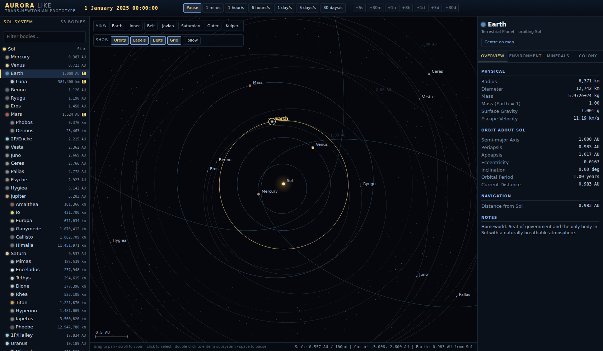

# aurora-like

A prototype 4X strategy game in the spirit of Aurora 4X: the dawn of the
trans-Newtonian age, starting in Sol and expanding outward.

This first milestone is the **system map** - the screen the rest of the game
hangs off. It models Sol to scale with real orbital elements, and lets you
open any body and inspect what a colony there would involve.



## Running it

```sh
npm install
npm run dev       # http://localhost:5173
npm run build     # typecheck + production build into dist/
npm run check     # orbital model sanity checks
```

## What is in the prototype

**A full model of Sol, to scale.** 53 bodies: the Sun, eight planets, five
dwarf planets, 30 moons, the larger asteroids, and two comets, plus ~1500
background objects filling the main belt, both Jupiter Trojan camps and the
classical Kuiper belt.

Positions come from Keplerian elements, not from an artist's impression:

- Planetary elements are JPL's J2000 mean elements, converted from
  (mean longitude, longitude of perihelion) to (mean anomaly, argument of
  perihelion).
- Satellite elements are referred to their primary's equator and folded into
  the ecliptic frame, so the Uranian system really does orbit on its side and
  Triton really does run retrograde.
- Kepler's equation is solved with a bracketed Newton iteration, which holds
  up at Halley's eccentricity of 0.967 where plain Newton-Raphson diverges.

`npm run check` verifies the model against published values - Earth sits
0.9833 AU from Sol at heliocentric longitude 100.4 degrees on 1 January 2025,
Luna stays between perigee and apogee, every orbit stays inside its own
periapsis/apoapsis over a century of simulated time, and derived gravities
match observation.

**Distances are honest.** There is no fudge factor: the map is a single
continuous zoom from 75 AU down to about 15000 km, and bodies are drawn at
their true radius once they are larger than a few pixels. Moons sit at their
real distance from their primary, so the Jovian system opens up as you zoom
into Jupiter rather than being a separate screen.

**Time.** Continuous rates from one minute per second up to thirty days per
second, plus discrete jumps (+5s through +30d) in the style of Aurora's turn
increments. The campaign opens on 1 January 2025.

**Body detail.** Every body opens into a four-tab panel:

- *Overview* - physical data, orbital elements, live distance from Sol and
  from Earth, and the light-speed signal delay to reach it.
- *Environment* - temperature, day length, atmosphere, and a colony cost
  derived from gravity, temperature and atmospheric pressure. Earth costs 0,
  Mars and Luna cost 2.0, Titan 3.6, Venus is effectively unreachable without
  terraforming, and gas giants have no surface at all.
- *Minerals* - trans-Newtonian deposits with accessibility, generated
  deterministically per body, weighted by class. Metallic asteroids such as
  Psyche run rich and shallow; gas giants hold only Sorium.
- *Colony* - population, infrastructure requirement, and installations.
  Earth, Luna and Mars start settled.

## Controls

| Input | Action |
| --- | --- |
| Drag | Pan |
| Scroll | Zoom at the cursor |
| Click | Select a body |
| Double-click | Zoom to a body, framing its satellite system |
| `Space` | Pause / resume |
| `1`-`7` | Time rate |
| `F` | Follow the selected body |
| `Esc` | Clear the selection |
| `+` / `-` | Zoom |

The **View** buttons jump to preset framings (Earth, Inner, Belt, Jovian,
Saturnian, Outer, Kuiper); **Show** toggles orbits, labels, belt objects and
the AU grid.

## Layout

```
src/
  sim/        orbit.ts      Keplerian mechanics, the frame, and the solver
              clock.ts      simulation time, rates and the civil calendar
              system.ts     body tree, per-tick positions, derived figures
              minerals.ts   deterministic deposit generation
  data/       bodies.ts     the Sol dataset: elements and physical data
  render/     camera.ts     pan/zoom over the ecliptic plane
              map.ts        canvas renderer
  state/      game.ts       game state and the actions the UI takes
              installations.ts
  ui/         app.ts        input, the frame loop, wiring
              bodyTree.ts, detailPanel.ts, timeControls.ts, format.ts
tools/        sanity.ts     the checks behind `npm run check`
```

The simulation layer knows nothing about the DOM, and the data layer knows
nothing about the simulation - which is what makes the next milestones
(multiple systems, ships and an economy) additions rather than rewrites.

## Not built yet

Ships and fleet movement, the research tree, an actual economy behind the
installation counts, ground forces, sensors and combat, jump points and other
star systems. Installations are added instantly with no cost or build queue;
population does not grow.
